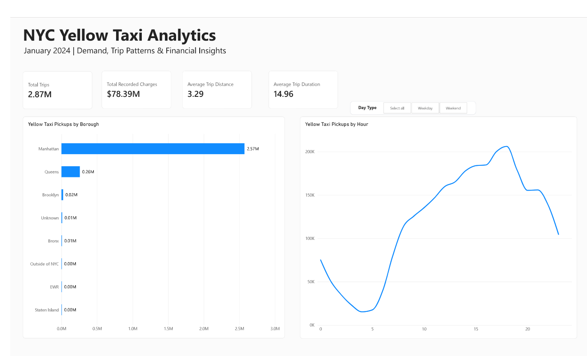
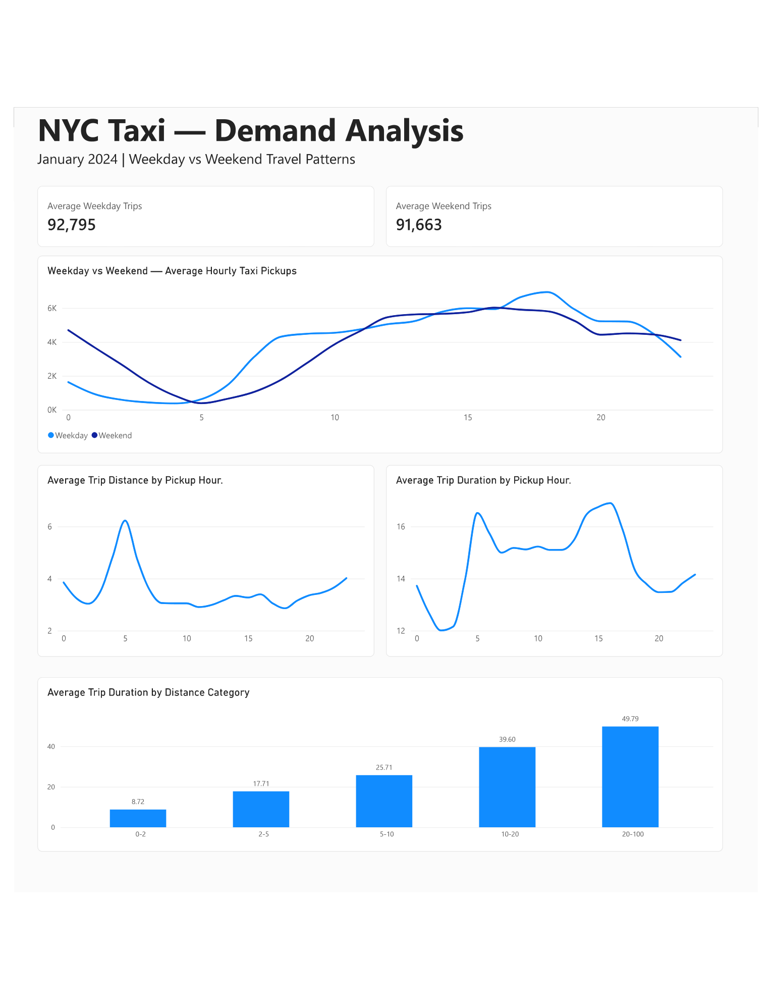
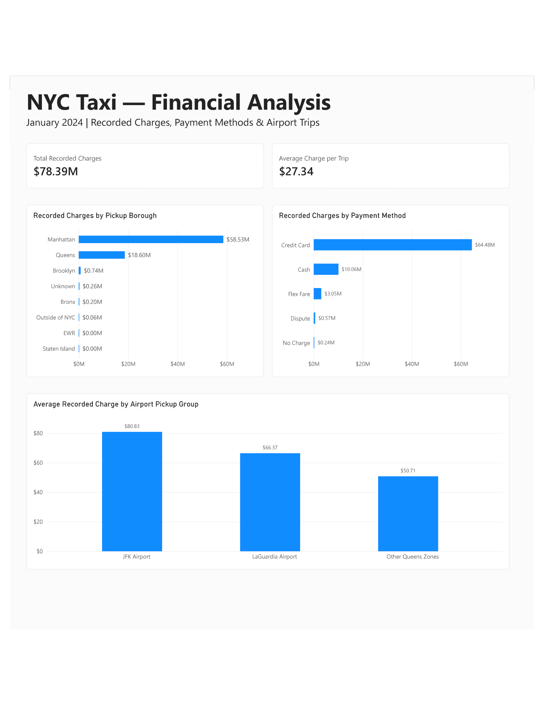

# NYC Yellow Taxi Analytics | Python, SQL & Power BI

## Project Overview

This project analyses **New York City Yellow Taxi trip data from January 2024** to understand travel demand, trip characteristics and recorded financial activity.

Using **Python, MySQL and Power BI**, I developed an end-to-end data analytics workflow covering data cleaning, exploratory analysis, SQL querying and interactive dashboard development.

The analysis began with approximately **2.96 million trip records**. After applying data quality filters, **2,867,591 trips** were retained for analysis.

## Business Objectives

The project addresses five key questions:

1. What are the busiest taxi pickup hours and boroughs in New York City?
2. How does taxi demand differ between weekdays and weekends?
3. How do trip distance and pickup time relate to journey duration?
4. How are recorded trip charges distributed across boroughs and payment methods?
5. How do average recorded charges compare between JFK Airport, LaGuardia Airport and other Queens pickup locations?

## Tools & Technologies

- **Python:** Pandas, NumPy and data cleaning
- **MySQL:** Data validation, aggregation and analytical queries
- **Power BI:** Interactive visualisations, DAX measures and dashboard development
- **VS Code & Jupyter Notebook:** Development and documentation

## Data Source

**Source:** NYC Taxi and Limousine Commission (TLC) — January 2024 Yellow Taxi Trip Records.

The dataset contains pickup and drop-off timestamps, trip distances, location IDs, fares, payment methods and other trip information.

Official source: https://www.nyc.gov/site/tlc/about/tlc-trip-record-data.page

**Note:** The full cleaned dataset is not included in this repository because of its file size. It can be reproduced from the source data using the Python notebook.

## Project Methodology

The project follows an end-to-end analytics workflow, from raw data preparation to business insights and dashboard development.

### 1. Data Collection
- Obtained January 2024 Yellow Taxi trip records and the taxi zone lookup dataset from NYC TLC.
- Loaded the source data into Python using Pandas.
- Examined the dataset structure, missing values and trip statistics.

### 2. Data Cleaning and Preparation
- Restricted the analysis to trips with pickup timestamps in January 2024.
- Applied quality filters to remove invalid trip durations, distances and non-positive fare or total amounts.
- Joined taxi zone lookup information to identify pickup and drop-off boroughs.
- Created analytical features including pickup hour, day type, trip duration and distance categories.
- Prepared a cleaned, 19-column reporting dataset containing **2,867,591 trips**.

### 3. SQL Analysis
- Imported the cleaned reporting dataset into MySQL.
- Used SQL aggregation and grouping to analyse trip demand, borough distribution and recorded charges.
- Compared weekday and weekend demand patterns, hourly trip characteristics and airport pickup groups.

### 4. Power BI Dashboard
Developed a three-page interactive report:

- **Executive Overview:** Overall trip volume, recorded charges, average distance, average duration and pickup demand.
- **Demand Analysis:** Weekday versus weekend patterns, trip distance, duration and distance-category comparisons.
- **Financial Analysis:** Recorded charges by borough and payment method, plus airport pickup comparisons.

### 5. Validation and Interpretation
- Cross-checked key trip counts and financial aggregates between analytical outputs.
- Verified that the Python notebook could reproduce the 19-column reporting dataset.
- Interpreted recorded charges as amounts reported in the trip records, not necessarily payments successfully collected.
- Documented key findings and limitations to support responsible interpretation.

## Key Findings & Business Insights

The following findings are based on **2,867,591 cleaned NYC Yellow Taxi trips from January 2024**.

### 1. Overall Trip Activity

- **Total trips:** 2,867,591
- **Total recorded charges:** $78.39 million
- **Average recorded charge per trip:** $27.34
- **Average trip distance:** 3.29 miles
- **Average trip duration:** 14.96 minutes

These metrics provide a baseline for understanding taxi activity and the value of recorded trip charges during the month.

### 2. Pickup Demand by Borough

- **Manhattan:** 2,571,717 pickups, approximately **89.68%** of analysed trips.
- **Queens:** 257,500 pickups, approximately **8.98%**.
- **Brooklyn:** 22,240 pickups, approximately **0.78%**.

**Business insight:** Yellow Taxi pickup demand was heavily concentrated in Manhattan. This suggests that Manhattan is an important area for investigating how taxi availability aligns with observed demand.

### 3. Peak Pickup Hours

- **Busiest pickup hour:** 6 PM, with 206,134 trips.
- **Lowest pickup hour:** 4 AM, with 15,252 trips.
- Weekday demand peaked around **6 PM**, while weekend demand peaked around **4 PM** when comparing average trips per day.

**Business insight:** Different weekday and weekend demand patterns may help operators identify when driver availability deserves closer attention.

### 4. Trip Distance and Duration

- **Average trip distance:** 3.29 miles.
- **Average trip duration:** 14.96 minutes.
- Trips beginning at **4 PM** had the highest average duration, approximately **16.90 minutes**.
- Trips beginning at **

## Power BI Dashboard

The interactive Power BI report contains three pages covering
overall taxi activity, demand patterns and financial analysis.

### 1. Executive Overview



### 2. Demand Analysis



### 3. Financial Analysis




## Project Structure

```text
NYC-Taxi-Analytics/
│
├── Notebook/
│   └── 01_data_exploration.ipynb
│
├── SQL/
│   ├── 01_database_setup.sql
│   ├── 02_data_import.sql
│   └── 03_business_analysis.sql
│
├── Dashboard/
│   └── NYC_Taxi_Analytics_Dashboard.pbix
│
├── Images/
│   ├── 01_executive_overview.png
│   ├── 02_demand_analysis.png
│   └── 03_financial_analysis.png
│
├── Data/
│   └── [Local datasets excluded from GitHub]
│
├── .gitignore
├── requirements.txt
└── README.md
```

**Note:** The full raw and cleaned datasets are stored locally and excluded from GitHub because of their file sizes.


## How to Reproduce the Analysis

### Prerequisites

- Python 3.10 or later
- VS Code or Jupyter Notebook
- MySQL 8.0 (for SQL analysis)
- Power BI Desktop (for the interactive dashboard)

### 1. Clone the Repository

```bash
git clone https://github.com/YOUR_USERNAME/NYC-Taxi-Analytics.git
cd NYC-Taxi-Analytics
```

Replace `YOUR_USERNAME` with your GitHub username.

### 2. Download the Dataset

Download the January 2024 Yellow Taxi trip records and taxi zone lookup CSV from the official NYC Taxi and Limousine Commission website:

https://www.nyc.gov/site/tlc/about/tlc-trip-record-data.page

Place these files inside the `Data/` folder:

- `yellow_tripdata_2024-01.parquet`
- `taxi_zone_lookup.csv`

### 3. Install Python Dependencies

```bash
python -m venv .venv
```

Activate the virtual environment on Windows:

```powershell
.venv\Scripts\Activate.ps1
```

Install the Python packages:

```bash
pip install pandas numpy pyarrow matplotlib seaborn jupyter ipykernel
```

### 4. Run the Notebook

Open:

`Notebook/01_data_exploration.ipynb`

Select the virtual environment as the Python kernel and run the notebook from top to bottom.

The notebook cleans and enriches the trip records and exports the reporting dataset to:

`Data/nyc_taxi_cleaned_jan2024.csv`

### 5. SQL Analysis

Import the cleaned CSV into MySQL and run the SQL scripts provided in the `SQL/` folder.

### 6. Power BI Dashboard

Open `Dashboard/NYC_Taxi_Analytics_Dashboard.pbix` in Power BI Desktop.

If Power BI cannot locate the cleaned CSV, update its data source to point to your local `Data/nyc_taxi_cleaned_jan2024.csv` file and refresh the report.
